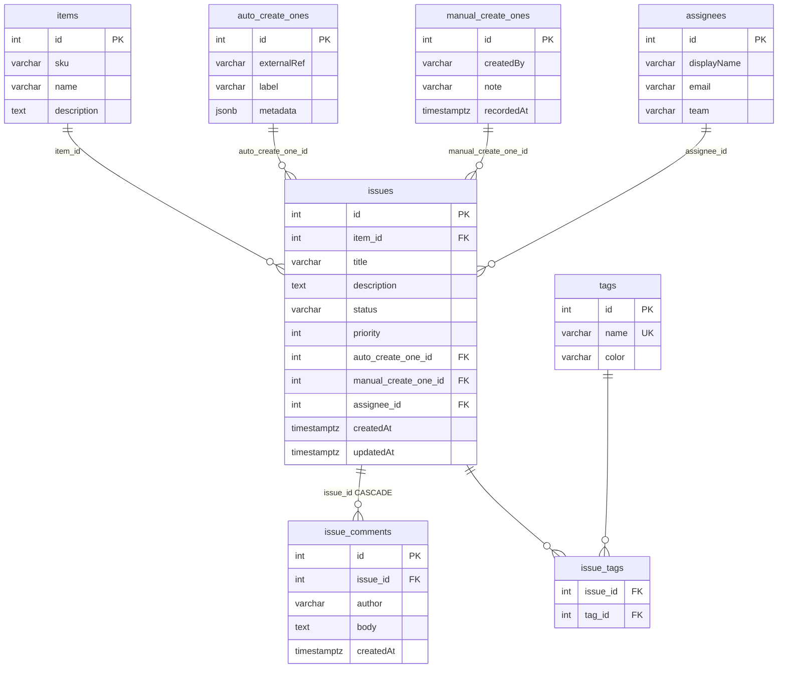

# TypeORM 0.3 practice workspace

Local full-stack environment for experimenting with heavy TypeORM `find` queries and deep `leftJoinAndSelect` loads. Use it to refactor toward QueryBuilder, selective `.select()` payloads, pagination, or split queries, then compare SQL, server time, and response size.

## Stack

| Layer | Tech |
|-------|------|
| Database | PostgreSQL 16 (Docker Compose) |
| Backend | Node.js, Express, TypeORM **0.3** |
| Frontend | Angular **18** (standalone components) |

The current query implementation lives in `backend/src/services/issue.service.ts` (`findHeavyByItemIds`): it joins the to-one relations and batch-loads comments and tags separately to avoid row multiplication from joining both collections. TypeORM SQL logging is enabled when `TYPEORM_LOGGING=true` in `backend/.env`.

## Prerequisites

- [Docker Desktop](https://www.docker.com/products/docker-desktop/) (or Docker Engine + Compose)
- Node.js 20+ (22 recommended)
- npm

## Quick start

From the repository root:

```bash
# 1. Start PostgreSQL
npm run docker:up

# 2. Backend setup (first time)
cd backend
cp .env.example .env    # Windows: copy .env.example .env
npm install
npm run seed            # ~5,000 issues + related data
npm run dev             # API on http://localhost:3000

# 3. Frontend (new terminal)
cd frontend
npm install
npm start               # UI on http://localhost:4200
```

Root shortcuts (after `npm install` in `backend/` and `frontend/`):

```bash
npm run docker:up
npm run backend:seed
npm run backend:dev
npm run frontend:dev
```

### Using the UI

1. Open http://localhost:4200
2. Set how many catalog **item IDs** to include in the `IN (...)` filter
3. Click **Run heavy fetch**
4. Compare **client time**, **server time**, **payload size**, and the issue table
5. Watch the backend terminal for generated SQL and slow-query warnings

### API

| Method | Path | Description |
|--------|------|-------------|
| `GET` | `/health` | Liveness check |
| `GET` | `/issues/meta/items` | Sample item IDs for the UI |
| `GET` | `/issues?itemIds=1,2,3` | Heavy join load (comma-separated item IDs) |

Default database credentials (see `docker-compose.yml`): user `orm_user`, password `orm_password`, database `orm_practice`, port `5432`.

## Project layout

```text
ORM/
├── docker-compose.yml
├── backend/          # Express + TypeORM, seed script, entities
└── frontend/         # Angular benchmark UI
```

## Database ER diagram

`issues` is the center of the join graph used by the benchmark endpoint.



### Relationships

| From | To | Cardinality | Notes |
|------|-----|-------------|--------|
| `items` | `issues` | 1 → N | `issues.item_id` required |
| `auto_create_ones` | `issues` | 1 → N | nullable FK |
| `manual_create_ones` | `issues` | 1 → N | nullable FK |
| `assignees` | `issues` | 1 → N | nullable FK |
| `issues` | `issue_comments` | 1 → N | `ON DELETE CASCADE` |
| `issues` | `tags` | N ↔ M | via `issue_tags` |

Seed data (approximate): **5,000** issues, **400** items, **3** comments per issue, **40** tags, **80** assignees.

## Where to experiment

1. Experiment with `IssueService.findHeavyByItemIds` (QueryBuilder, partial selects, pagination, or alternate relation-loading strategies).
2. Re-run the UI fetch and compare metrics.
3. Inspect SQL and execution time in the backend console (`TYPEORM_LOGGING=true`).
